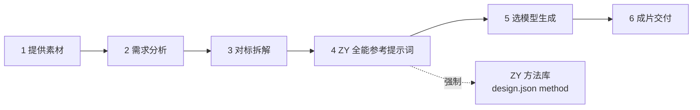

# 映流 MV · Agent 原生视觉工作流

技能名 `yingliu-mv`。本仓库已用映流 MV v1.0.5 完整替换旧版工作流，旧内容可从 Git 历史恢复。新版不依赖旧工作流、Qwen、模型权重或凭证；ZY 方法库已作为设计阶段的必需环节内置在 `vendor/zy-cinematic-realism/`（见下节）。

[下载可直接安装的 Skill ZIP](dist/yingliu-mv-v1.0.5.zip) · [依赖清单与检查](DEPENDENCIES.md) · [新用户操作顺序](references/new-user.md)

优先下载上面的 Skill ZIP，解压后目录名为 `yingliu-mv`。GitHub 的 Download ZIP 是源码归档，若用于安装请把解压根目录改名为 `yingliu-mv`。离线演练的 `--archive` 参数使用 dist 中的 Skill ZIP。

## ZY 方法库（流程必需）

`vendor/zy-cinematic-realism/` 内置 ZY Cinematic Realism / 造梦师 v2.5.0，是设计阶段的强制环节：storyboard 阶段必须按 [ZY 集成](references/zy-cinematic-integration.md) 用它完成 Scene Master、Creative Grammar、连续性与结果修复，并把结果写入 `design.json` 的 `global` / `scenes` / `shots`。

`design.json` 顶层必须声明 `"method": "zy-cinematic-realism"`；未声明时 `compile`、`render --mode preview`、`pack --shot` 会直接阻断。它不改时间轴、歌词与口型。

该组件为 **CC BY-NC 4.0**（含非商业限制），署名与来源见 [THIRD_PARTY_NOTICES.md](THIRD_PARTY_NOTICES.md)；商业使用需另行取得上游授权。

## 工作流程

六步，前四步由 Agent 与你协作完成，第五步你选模型，第六步出片。



| 步 | 你做什么 | Agent 做什么 | 产物 | 内部阶段 |
|---|---|---|---|---|
| 1 提供素材 | 参考视频、参考音色、人物图、原曲、歌词 | 登记素材指纹，核对实际可用能力 | `project.json`、`input/` | prepare |
| 2 需求分析 | 说明目标、画幅、预算、交付要求 | 拆歌曲结构与歌词，写创意提案 | `concept.json`、`timeline.json` | concept |
| 3 对标拆解 | 确认可迁移与不可迁移项 | 实际观看参考视频，记录镜头统计与节奏，转成设计约束 | `concept.json` 的 `baseline` 字段 | concept |
| 4 全能参考提示词 | 确认 ZY 构造结果 | 按 ZY 方法库写 `design.json`（含 `omni_reference`），编译 | `design.json`、`prompts/` | storyboard |
| 5 选模型生成 | 选定后端、预算、并发 | 出样片 → 审查 → 批量生成 → 逐段审查 | `clips/`、`edit.json` | pilot + production |
| 6 成片交付 | 完整观看并确认 | 本地剪辑、拼接片段自带音频、出技术信息与报告 | `final_mv.mp4`、`delivery_report.json` | delivery |

**第 5 步内含两个不能省的审批点**：样片审查（`pilot`）通过才允许批量生成；逐段审查通过才允许正式合成。

参考音色是给视频模型的**生成条件**（提示约束），模型据此自行生成音频；交付成片默认就用片段自带的模型音频，母带不再重贴。只有当片段缺音轨或你要回退时，才把 `project.json` 的 `delivery_audio` 设为 `master`。

### 三个硬闸门

1. **ZY 方法闸**：`design.json` 必须声明 `"method": "zy-cinematic-realism"`，否则 `compile`、`render --mode preview`、`pack --shot` 直接阻断。
2. **时间轴闸**：`timeline.verified` 必须对应真实复核，且 `evidence_path` 指向的原始依据文件存在且非空；不能靠改 `verified` 绕过。
3. **审批闸**：`approve` 把确认声明绑定到当前阶段文件、引用素材与观察版本；相关文件一变，审批即失效。

### 命令时序

```powershell
python scripts/mv.py init     ../我的MV     # 建项目（不覆盖已有目录）
python scripts/mv.py status   ../我的MV     # 查当前阶段与待补项
python scripts/mv.py pack     ../我的MV     # 取当前阶段输入包
# …按 pack 列出的文档完成本阶段产物，交由用户确认…
python scripts/mv.py approve  ../我的MV --reviewer "用户" --evidence "确认原文"
python scripts/mv.py compile  ../我的MV     # 展开 design.json → prompts/
python scripts/mv.py render   ../我的MV --mode preview
python scripts/mv.py frames   ../我的MV --media clips/pilot.mp4 --count 8
python scripts/mv.py observe  ../我的MV --record state/drafts/observe.json
python scripts/mv.py render   ../我的MV --mode final
python scripts/mv.py report   ../我的MV
```

`render` 不会自动批准，也不会自动调用生成后端；`approve` 只登记用户确认，不认证观看真实性。

## 使用

需要 Python 3.10+；抽帧、预演和合成需要 PATH 中的 FFmpeg/FFprobe。核心状态管理只用 Python 标准库。Agent 视觉、ASR、图片/视频生成使用用户已有工具，供应商费用另计。

完整清单和外部能力说明见 [依赖说明](DEPENDENCIES.md)。分享前执行 `python scripts/mv.py doctor --smoke`；不能把本地依赖通过理解为已经具备生成后端和视频理解能力。

第一次使用请按 [新用户完整操作顺序](references/new-user.md) 执行。版本 1.0.5 提供可复跑的 ZIP 隔离安装及离线出片演练，所有模拟审查与正式项目分开。

将整个目录放入接收者的技能目录，例如 `~/.codex/skills/yingliu-mv/`，刷新技能后用 `$yingliu-mv`。也可以把本目录和素材路径交给支持本地工具的 Agent，要求先读 `SKILL.md`。本次交付只创建工作区副本，不修改用户全局技能目录。

在本包目录执行：

```powershell
python scripts/mv.py doctor
python scripts/mv.py init ../我的MV
python scripts/mv.py status ../我的MV
python scripts/mv.py pack ../我的MV
```

把原曲和歌词放入项目 `input/song.wav`、`input/lyrics.txt`，或修改 `project.json` 中相对路径。音频支持 FFmpeg 可读取格式。不要把凭证写进项目或共享压缩包。

Agent 按当前阶段编写文件，用户确认后登记：

```powershell
python scripts/mv.py approve ../我的MV --reviewer "用户" --evidence "用户明确确认当前阶段产物的原文"
python scripts/mv.py compile ../我的MV
python scripts/mv.py render ../我的MV --mode preview
python scripts/mv.py frames ../我的MV --media clips/pilot.mp4 --count 8
python scripts/mv.py observe ../我的MV --record 我的观察.json
python scripts/mv.py observations ../我的MV --media clips/pilot.mp4
python scripts/mv.py pack ../我的MV --shot SH001
python scripts/mv.py render ../我的MV --mode final
python scripts/mv.py report ../我的MV
```

`approve` 记录人工确认声明，绑定已完成阶段和当前证据，不是独立数字签名。默认六阶段确认；本版不提供旧工作流的十二步独立签名模式。用户需要该模式时继续使用原工作流，不能将本版审批记录当作等价替代。

预演使用 `design.json` 每镜的 `image`，正式合成使用 `edit.json` 的视频选段。渲染不自动批准，不自动调用生成后端。输入格式与示例由 `init` 建立；详细字段见 `references/data.md`。

## 边界与优化

- 原生视觉须由 Agent 实际调用看图/视频工具；CLI 只登记观察，无法直接调用宿主 Agent。
- 时间轴、创意和分镜由 Agent/用户配合已有工具填写，CLI 不会自动理解歌曲或创作故事。
- 样片/全片审查需要明确观察范围及未核实项；机器检查不证明审美或真实口型。
- 阶段输入包按需加载、逐镜包带邻镜；素材变化使关联观察失效。阶段审批保守绑定前序证据，可能需要重新确认后续阶段，但不自动重新生成素材。
- 没有付费 API 派发器，不会自动消费预算；外部工具调用前遵守 `vision-generation.md`。`jobs.json` 仅离线任务台账，不是供应商结算证明。
- `report` 只出具本地交付清单与状态，未经最终确认不标记完成。

验证：`python -m unittest discover -s tests -v`。节省比例需用相同歌曲、镜头数和生成后端实测，不能由文件大小推定。

字段范例见 `examples/`；其中内容为合成设计示意，不能作为真实制作的复核证据。

`observe --record` 的相对路径从项目根目录解析。使用 `review-init --stage storyboard|pilot|delivery --media ... --observations ...` 创建待审模板，不自动批准。
