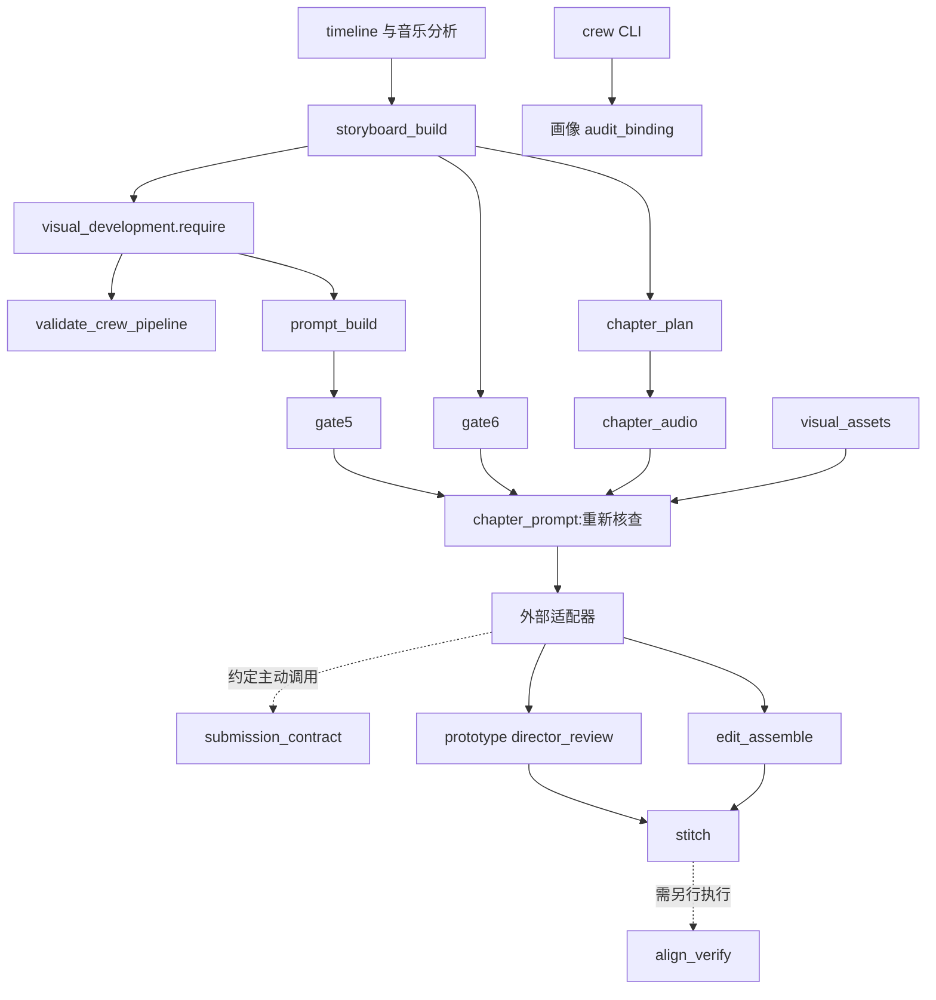

# 项目文件与门禁深度审计

审计日期：2026-10-14。对象为当前含 V1.5/V1.6 未提交改动的本地工作区，不能等同于 GitHub master。审计采用文件索引、Python AST、关键执行链源码核查和最小反例；本轮未修改生产脚本。

修复更新（2026-10-14）：A01–A05及A06–A36的代码/门禁/文档修订已加入本地工作区。当前状态与迁移见 `production-hardening.md`，专项测试见 `tests/test_production_contracts.py`；A33真实大型电影语料验证仍需合法外部数据。下文反例仅保留为修复前审计证据，不代表现版本行为。

## 文件覆盖与复核材料

对主项目非隐藏文件建立 551 项内容指纹清单，其中 31 项 Python 文件含函数/类行号和 import 索引。这包含历史产物与非核心文件；不把 551 项全部称为运行源码。

本机研究目录 `<WORKSPACE>/github-research` 保存：

- `mv-file-inventory.json`：逐文件大小、SHA-256、行数、Python 定义与 imports。
- `mv-gate-probes.json`：五个最小反例的实际结果。
- `audit_mv.py`：可重复运行的索引/反例审计器。
- `DEEP_REVIEW.md`：16 个第三方仓库及十一类工作流差距。

本报告不宣称已运行每个第三方应用、逐行验证所有历史文件或通过真实成片审美验收。

## 核心脚本逐文件职责与检查路径

| 文件（scripts/） | 输入→输出 | 实际门禁/关键观察 |
|---|---|---|
| timeline_fallback.py | 分析 WAV、歌词→timeline | 均匀估时、低置信待核；无正式 ASR 实现 |
| storyboard_build.py | timeline/music/edit/story→storyboard | 音乐引用、连续全曲、景别/口型、故事字段；不自动调用 ZY 执行创作 |
| visual_development.py | development/storyboard/style→错误列表 | 来源、导演文件指纹、连续性、八部门；画像检查缺失 |
| crew_pipeline.py | development/storyboard→crew gate | 八部门/交接/机位/动线/节奏；CLI 才附画像检查 |
| film_grammar_corpus.py | JSONL/manifest→profile；project/profile→audit | 语料来源/样本数/镜长统计；无数据集原生格式导入器 |
| prompt_build.py | 设计→场景/关键帧/运动/总提示词 | require_development；包含多套摄影/动作字段，冲突尚无统一解析 |
| gate_checks.py | timeline/style/storyboard/prompts→JSON/HTML | CLI 仅 gate1/gate5/gate6；其余关在别处或仅 SOP |
| visual_assets.py | 设计/媒体/证据→asset registry | 哈希和父子依赖；scope 未覆盖全片 crew_bible |
| chapter_plan_build.py | storyboard/edit/limit→chapters | 正式口型时间权威、导演剪辑批准；未重验完整 gate5/6 |
| chapter_audio_build.py | chapters/master→WAV/manifest/plan更新 | 保留采样率声道；未重验章节源分镜指纹与口型权威 |
| chapter_prompt_build.py | plan/prompts/assets→chapter package | 重验 gate6、gate5记录、提示词/设计/资产指纹；未统一画像预检 |
| omni_reference.py | chapter/beats/assets→blueprint | 职责、引用、正向相邻时间；来源存在性很弱，缺首尾完整覆盖 |
| submission_contract.py | 外部已解析契约→PASS/错误 | omni能力/引用/角色/音频开关；时长、预算、审片与主项目缺关联 |
| director_review_gate.py | plan/review/media→批准 | 样片媒体哈希、声明证据、记录内依赖；依赖集合可删减 |
| edit_assemble.py | storyboard/clips/selection→裁切/assembly | 源文件哈希、整帧选段、帧率；render 不先检查导演批准 |
| stitch_chapters.py | assembly或历史clips/master→final | 样片批准、assembly指纹；固定24fps、缺全片逐章审片与最终自动验收 |
| duration_fit.py | clip/window/fps→fitted | 裁剪/冻结末帧；用目标fps解释输入帧数有风险 |
| render_preview.py | 图片/分镜/master→preview | Ken Burns 预览与音频比较；verify FAIL 仍可能正常退出 |
| audio_master.py | timeline/master→编码参数 | 保留原音频流或ALAC；未强制母带来源哈希锁 |
| restore_master_audio.py | existing video/master→new video/report | 拒绝覆盖、音视频载荷比对；验证强于常规 stitch |
| align_verify.py | 16k参考/候选/设计→report | 音频包络与时长；未读取视频帧或嘴唇，self_reference 可PASS |
| visual_revision.py | base/candidate/repair→结果 | 顶层变化字段与修复声明；不检查修复产物与素材版本 |
| ledger.py | action/cost→JSONL汇总 | 记账；无现金预算预约、并发锁、幂等任务ID |

## 门禁真实执行图

注意：本仓库没有生成任务调度器。外部适配器是否真正调用 submission_contract、先样片再批量、遵守预算，并未由当前核心代码强制执行。

## 五项已复现问题

| ID | 优先级 | 反例与实际结果 | 代码依据 |
|---|---|---|---|
| A01 | P0 | development 声明不存在画像且 enforce_envelope，validate 返回空错误列表 | visual_development.py:149；crew_pipeline.py:376 |
| A02 | P1 | 修改全片 lighting.contrast_arc，场景母版 scoped_snapshot 不变 | visual_assets.py:22 |
| A03 | P1 | 相邻 angle=179/-179，实际差2°但没有30°错误 | crew_pipeline.py:312 |
| A04 | P0 | 提交镜头 start=10/end=5 并与下一镜重叠，提交契约仍PASS | submission_contract.py:153 |
| A05 | P1 | 4秒样片填写999–1000秒观察证据，validate_review 仍无错误 | director_review_gate.py:87 |

A03 另被景别种类规则阻断，但不是正确的30°判断；不能拿其他规则失败掩盖该缺陷。

## 其他源码确认的门禁缺口

| ID | 优先级 | 触发与后果 | 修复/验收方向 |
|---|---|---|---|
| A06 | P0 | review.dependencies 只要求非空，可删掉 storyboard/development 等必需项后沿用旧批准 | 固定必需依赖集合+实际指纹；完整关联提示词、音频和资产文件 |
| A07 | P0 | submission 只接受 director_cut_status=approved 字符串，未核对项目、章节、审片记录和指纹 | project/chapter/package hash + 可信审片事实，不以字符串放行批量 |
| A08 | P1 | 多镜能力只在 edit_shots 数量>1时检查；空列表可回避时间轴能力和时序检查 | 必需真实shot列表，正向有限时间、首尾覆盖、唯一ID、预算/规格上限 |
| A09 | P1 | omni_reference 与 submission 意图词表不同：blocking_start_state 在前者有效后者不接受 | 共享领域词表；适配差异显式映射与回归 |
| A10 | P1 | source只带sha256或chapter_id即可算存在，音频资产尚未制作也可成为蓝图占位 | 区分planned/available/uploaded；提交前验证文件/托管资产与哈希 |
| A11 | P1 | blueprint float NaN 未用isfinite校验，首镜不强制从0开始，末镜不核对chapter duration | 有限数+绝对/相对时间约定+完整覆盖 |
| A12 | P1 | 两处以上摄影景别/camera字符串与crew.cinematography互相独立，可相互矛盾 | 单一事实源→所有提示词派生，冲突阻断 |
| A13 | P1 | selected coverage仅要求materialized_shot_id非空，不核验该ID确实存在且对应候选 | 验证编辑/故事正式镜头引用、窗口和来源关系 |
| A14 | P1 | 相同轴线改axis_id名称绕过越轴检查；axis_reset=true不要求桥接证据 | 场景轴线注册表+几何判定+桥接镜ID/时间码 |
| A15 | P1 | entry/exit动线在不同场景也比较，误判合理跨场剪辑 | continuity group/time relation 与边缘/向量分开 |
| A16 | P1 | coverage_requirements只检查非空，固定角色配额又可能阻断演唱/蒙太奇 | 按scene kind/目标声明并逐镜兑现 |
| A17 | P1 | hook字段用bool()，字符串false也为true；次数阈值可为小数被int截断 | 严格类型，整数规则拒绝bool/浮点，hook必须实际布尔 |
| A18 | P1 | 门禁1只核歌词行数，替换歌词文本但保留行数仍可通过；不逐行验正向区间 | 文本规范化对照+索引唯一+有限时间+范围检查 |
| A19 | P1 | fallback能登记低置信待核并通过gate1结构，但章节权威另处判断 | gate1明确structural/provisional/production，所有正式入口消费统一结论 |
| A20 | P1 | 已批准样片只代表prototype；stitch无全部章节动态验收要求 | 逐章审批和全片序列审片+依赖失效 |
| A21 | P1 | edit_assemble --render可跳过样片审批；仅stitch限制正式合成 | 设计是否允许技术预览显式标记；正式剪辑统一preflight |
| A22 | P1 | stitch固定-r24与storyboard.fps不一致；画布可与style比例不一致 | 从项目派生CFR/比例；输出真实帧数、画布和流属性核验 |
| A23 | P1 | stitch末尾只打印时长，-shortest可能截短，不因偏差返回失败 | 产物视频/音频实测+帧容差+失败退出+验收报告 |
| A24 | P1 | duration_fit以目标fps解释输入nb_frames，输入真实fps不同可错误走copy快路径 | probe输入实际fps/时基/VFR；不只拿帧数除目标fps |
| A25 | P1 | 接受dissolve/J_cut/L_cut但本地edit/stitch只trim+concat，没有相应实现 | 设计/后端/本地实现支持矩阵；未经实现不宣称执行完成 |
| A26 | P1 | align_verify的clips_sum来自storyboard并未读实际clips；音频包络不能判口型 | 分离planned/actual视频长度、音频时间、口型动态审查 |
| A27 | P1 | align_verify省略candidate仍可overall PASS | self_reference只作diagnostic；正式验收必须绑定真实成片 |
| A28 | P1 | stitch只检查母带路径和编码，未比较原始上传母带指纹与最终载荷 | master source hash+编码/解码载荷一致性证据 |
| A29 | P2 | gate5重复shot ID被dict覆盖，完整覆盖以覆盖后的集合检查 | 入口先统一schema/唯一ID验证；校验器不信任构建器曾跑过 |
| A30 | P2 | 母版登记agent_inspected=true由工具自动写；未验证媒体类型/实际观察 | 明确declared inspection；图像尺寸/type检查，审片证据另存 |
| A31 | P2 | 多文件写入中途中断可留下部分新产物与旧状态；暂无统一事务 | 临时写入、原子替换、manifest最终提交与resume恢复 |
| A32 | P2 | 金额接受任意float，NaN/重复提交/返还没有幂等关联，现金封顶仅约定 | 有限Decimal、task ID、预占/结算、重试/退款关联 |
| A33 | P2 | 画像以项目平均值对单镜p10/p90，来源/影片分组与词表不一致 | 同层统计、分类型、来源版本键与统一映射；真实语料验证 |
| A34 | P2 | README称全自动，实际故事/时间权威/生成/审片主要靠外部执行 | 文档逐步声明implemented/manual/external；给入口和产物证据 |
| A35 | P2 | gates-spec描述八道关，而gate CLI只有1/5/6；门禁数量和21项指纹追加也未同步 | 生成门禁registry，标明入口、失败码、执行者、必要依赖与阶段 |
| A36 | P2 | render_preview记录verification FAIL但脚本末尾无失败退出 | 明确预览生成成功与验收失败两种状态，不混用退出码 |

## 文档、vendor 与历史产物审计

SKILL.md 是流程说明，不是状态机。references/gates-spec.md 是宣称的规则；每项必须链接实际入口。data-schemas.md 仍含历史示例，应提供版本化可执行schema；architecture.md 的时间线推导描述需与music_referenced_visual_edit保持一致。

vendor/zy-cinematic-realism 包含静帧视觉开发、参考职责、导演路由、连续性与修复说明。代码通过字段和导演文件SHA核验，不能证明Agent实际读完/使用了创作方法。要保留逐镜方法理由和画面证据，而不新增“调用skill=true”式虚假标记。当前vendor导演文件不存在 Quentin Tarantino；指定昆汀时不能写不存在的source_file或冒用其他导演。

tests/ 两个主测试模块已有62项通过的上一轮记录，覆盖多数正常流程与若干负例；本轮五个新反例暴露未覆盖行为，说明62项通过不是完整门禁证明。历史报告/产物不能视为当前工作区审批；需要同一版本、同一媒体和同一输入指纹。

## 修复顺序

1. P0：统一项目级preflight，修复画像入口漏检；审片固定依赖；提交包完整时序和项目/章节/批准来源绑定。
2. P1：圆周角、轴线/动线组、coverage与bool类型；全片crew依赖；实际帧率与产物长度；母带和口型验收分离。
3. P1：构图/调度/美术/灯光look test、动态样片与全片审片；将多套描述编译成同一事实源。
4. P2：schema/registry/原子写入/并发成本/真实语料转换；同步文档与历史迁移。

每个修复至少覆盖一个上述反例、一个有效创作例外和一个真实入口集成路径。机器结构通过、静帧合格、动态连续性合格、艺术审片合格应分别记录。
